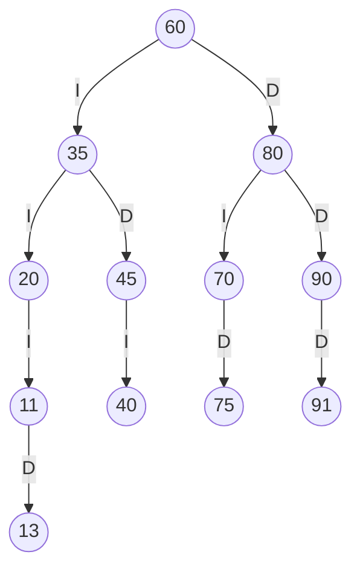
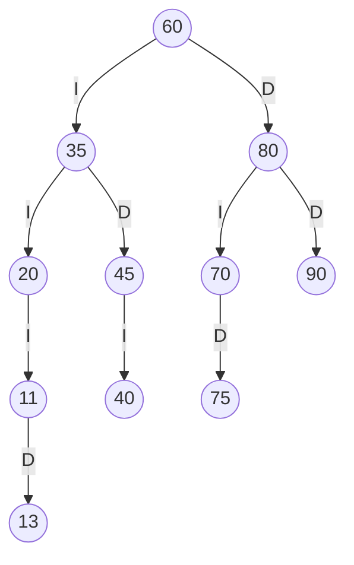
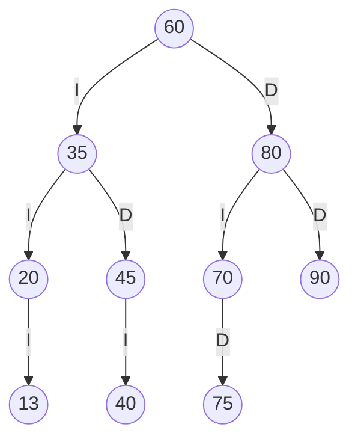
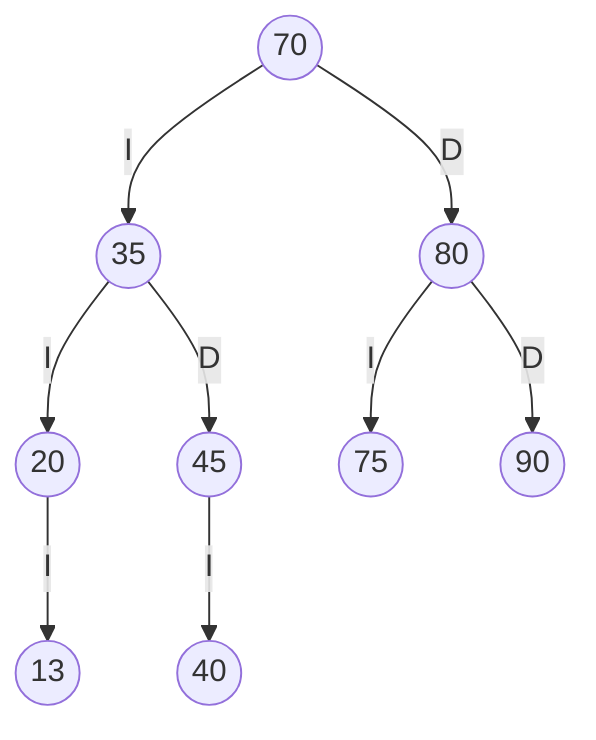

# Trazas del catálogo de la Biblioteca FISEI

## 1. Datos del ejercicio

Se utiliza el ABB del estante SW-E1.

Los códigos iniciales se insertan en este orden:

```text
60, 35, 80, 20, 45, 70, 90, 40, 75
```

Los tres códigos personales obtenidos mediante las parejas ab, bc y cd son:

| Pareja | Código obtenido | Ajuste necesario | Código final |
| ------ | --------------- | ---------------- | ------------ |
| ab     | 91              | Ninguno          | 91           |
| bc     | 11              | Ninguno          | 11           |
| cd     | 13              | Ninguno          | 13           |

Ninguno es cero, está repetido ni pertenece al catálogo inicial.

Los códigos personales se insertan en el orden 91, 11 y 13. Cada libro tiene como título Libro personal seguido de su código, autor Jampier Camacho y año 2026.

## 2. Construcción del ABB inicial

| Código | Comparaciones y ubicación                                    |
| ------ | ------------------------------------------------------------ |
| 60     | El árbol está vacío; se convierte en raíz.                   |
| 35     | 35 < 60; queda como hijo izquierdo de 60.                    |
| 80     | 80 > 60; queda como hijo derecho de 60.                      |
| 20     | 20 < 60 y 20 < 35; queda como hijo izquierdo de 35.          |
| 45     | 45 < 60 y 45 > 35; queda como hijo derecho de 35.            |
| 70     | 70 > 60 y 70 < 80; queda como hijo izquierdo de 80.          |
| 90     | 90 > 60 y 90 > 80; queda como hijo derecho de 80.            |
| 40     | 40 < 60, 40 > 35 y 40 < 45; queda como hijo izquierdo de 45. |
| 75     | 75 > 60, 75 < 80 y 75 > 70; queda como hijo derecho de 70.   |

## 3. Inserción de los códigos personales

| Código | Camino de comparación              | Posición final        |
| ------ | ---------------------------------- | --------------------- |
| 91     | 91 > 60; 91 > 80; 91 > 90          | Hijo derecho de 90.   |
| 11     | 11 < 60; 11 < 35; 11 < 20          | Hijo izquierdo de 20. |
| 13     | 13 < 60; 13 < 35; 13 < 20; 13 > 11 | Hijo derecho de 11.   |

En cada inserción, el caso base se alcanza cuando la referencia del hijo correspondiente es null. Se crea el nuevo nodo y se devuelve para enlazarlo con su padre.

## 4. ABB con los códigos personales

Las aristas I y D identifican al hijo izquierdo y derecho, respectivamente.



- Total de libros de SW-E1: 12.
- Raíz: 60.
- Altura: 4 aristas.
- Camino de máxima longitud: 60 → 35 → 20 → 11 → 13.
- Hojas: 13, 40, 75 y 91.

## 5. Recorridos del ABB personal

### Preorden

Orden de procesamiento: nodo, subárbol izquierdo y subárbol derecho.

```text
60 35 20 11 13 45 40 80 70 75 90 91
```

### Inorden

Orden de procesamiento: subárbol izquierdo, nodo y subárbol derecho.

```text
11 13 20 35 40 45 60 70 75 80 90 91
```

El resultado es ascendente porque el ABB mantiene los códigos menores a la izquierda y los mayores a la derecha.

### Posorden

Orden de procesamiento: subárbol izquierdo, subárbol derecho y nodo.

```text
13 11 20 40 45 35 75 70 91 90 80 60
```

## 6. Traza del preorden

entra indica la llegada a un nodo existente, VISITA indica el procesamiento de su código y null -> regresa representa el caso base.

La sangría aumenta dos espacios por nivel.

```text
entra 60
VISITA 60
  entra 35
  VISITA 35
    entra 20
    VISITA 20
      entra 11
      VISITA 11
        null -> regresa
        entra 13
        VISITA 13
          null -> regresa
          null -> regresa
      null -> regresa
    entra 45
    VISITA 45
      entra 40
      VISITA 40
        null -> regresa
        null -> regresa
      null -> regresa
  entra 80
  VISITA 80
    entra 70
    VISITA 70
      null -> regresa
      entra 75
      VISITA 75
        null -> regresa
        null -> regresa
    entra 90
    VISITA 90
      null -> regresa
      entra 91
      VISITA 91
        null -> regresa
        null -> regresa
Secuencia PREORDEN: 60 35 20 11 13 45 40 80 70 75 90 91
```

Hay 13 referencias nulas: un árbol binario con 12 nodos tiene 24 referencias de hijos y 11 enlaces entre nodos; las 13 restantes son null.

## 7. Eliminaciones

Las eliminaciones se realizan sobre el árbol personal en este orden:

```text
91 → 11 → 60
```

No se recarga la estructura inicial entre operaciones.

### 7.1. Eliminar 91: nodo hoja

Camino de búsqueda:

```text
60 → 80 → 90 → 91
```

91 no tiene hijos. Se elimina devolviendo null y la referencia derecha de 90 queda vacía.



Preorden esperado:

```text
60 35 20 11 13 45 40 80 70 75 90
```

Quedan 11 libros en SW-E1.

### 7.2. Eliminar 11: nodo con un hijo

Camino de búsqueda:

```text
60 → 35 → 20 → 11
```

11 tiene únicamente el hijo derecho 13. El método devuelve ese hijo y la referencia izquierda de 20 pasa a apuntar a 13.



Preorden esperado:

```text
60 35 20 13 45 40 80 70 75 90
```

Quedan 10 libros en SW-E1.

### 7.3. Eliminar 60: nodo con dos hijos

60 es la raíz y tiene dos hijos. Se busca el sucesor inorden, es decir, el menor código de su subárbol derecho.

```text
Subárbol derecho: 80 → izquierda → 70
Sucesor inorden: 70
```

Se reemplaza el dato de la raíz por el libro 70. Después se elimina el nodo original de 70, cuyo hijo derecho 75 pasa a ocupar su posición como hijo izquierdo de 80.



Preorden esperado:

```text
70 35 20 13 45 40 80 75 90
```

Quedan 9 libros en SW-E1. La raíz es 70 y la altura es 3 aristas.

El sucesor permite conservar el orden del ABB: es mayor que todos los códigos del subárbol izquierdo y menor que los códigos restantes del subárbol derecho.

## 8. Comparación con la ejecución

Para obtener las salidas se utilizó app.Main:

1. Opción 1: cargar nuevamente la estructura inicial.
2. Opción 6: insertar 91, 11 y 13 en SW-E1.
3. Opción 10: consultar los tres recorridos y la traza.
4. Opción 9: eliminar 91, 11 y 60, en ese orden.
5. Opción 10: consultar el preorden final.

| Comprobación       | Resultado esperado                               | Resultado observado                               | ¿Coincide? |
| ------------------ | ------------------------------------------------ | ------------------------------------------------- | ---------- |
| Insertar 91        | Libro insertado                                  | Inserción completada según la ejecución realizada | Sí         |
| Insertar 11        | Libro insertado                                  | Inserción completada; aparece en los recorridos   | Sí         |
| Insertar 13        | Libro insertado                                  | Inserción completada; aparece en los recorridos   | Sí         |
| Preorden personal  | 60 35 20 11 13 45 40 80 70 75 90 91              | 60 35 20 11 13 45 40 80 70 75 90 91               | Sí         |
| Inorden personal   | 11 13 20 35 40 45 60 70 75 80 90 91              | 11 13 20 35 40 45 60 70 75 80 90 91               | Sí         |
| Posorden personal  | 13 11 20 40 45 35 75 70 91 90 80 60              | 13 11 20 40 45 35 75 70 91 90 80 60               | Sí         |
| Traza del preorden | entra, VISITA, null -> regresa y secuencia final | Se muestran los pasos y la secuencia esperada     | Sí         |
| Eliminar 91        | Libro eliminado                                  | Eliminación realizada durante la ejecución        | Sí         |
| Eliminar 11        | Libro eliminado                                  | Eliminación realizada durante la ejecución        | Sí         |
| Eliminar 60        | Libro eliminado                                  | Libro eliminado                                   | Sí         |
| Preorden final     | 70 35 20 13 45 40 80 75 90                       | 70 35 20 13 45 40 80 75 90                        | Sí         |

Los preórdenes de las secciones 7.1 y 7.2 representan los estados intermedios calculados. La captura final comprueba el estado obtenido después de las tres eliminaciones.

## 9. Evidencias

Las capturas de esta ejecución se guardan con los siguientes nombres:

- 13_Insercion_Personal_91.png
- 14_Insercion_Personal_11.png
- 15_Insercion_Personal_13.png
- 16_Preorden_Personal_Completo.png
- 17_Inorden_Personal.png
- 18_Posorden_Personal.png
- 19_Eliminar_Personal_91_Hoja.png
- 20_Eliminar_Personal_11_Un_Hijo.png
- 21_Eliminar_Personal_60_Dos_Hijos.png
- 22_Preorden_Final_Personal.png

Las pruebas generales del programa se ejecutaron mediante app.PruebasBiblioteca y finalizaron con:

```text
41/41 pruebas OK
```
